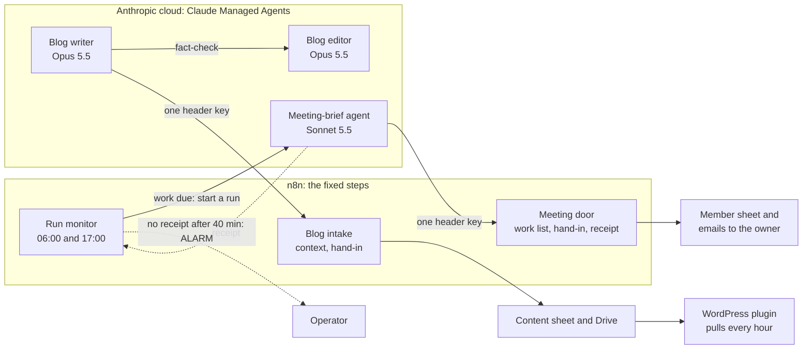

# Cloud agents

Two AI agents I built and run on Claude Managed Agents (Anthropic's cloud) for a small business. They work on their
own: no laptop on, nobody at a keyboard. Each one holds a single key to a single n8n "door", a person approves what
matters, and every run is measured.

This is a clean copy of agents in production since October 2026. The live repos stay private because they hold client
data, so here the client's details are replaced by placeholders and made-up examples, and the git history starts fresh.

Ian Jay Panisales

## The two agents
| | [Meeting-brief agent](meeting-brief-agent/) | [Blog agent](blog-agent/) |
|---|---|---|
| The owner's task it takes over | Researching each person before a networking 1-2-1, preparing questions, drafting the thank-you after | Planning, researching, writing, fact-checking and illustrating a blog post |
| Model | Claude Sonnet 5.5 | Claude Opus 5.5: a writer, plus a separate fact-checking editor agent |
| Started by | n8n, twice a day, only when a brief or a thank-you is due | Its schedule, or on demand |
| Delivers | A brief and 5 questions, emailed the morning before; a thank-you draft the owner sends | A finished post and thumbnail through the n8n intake to the content sheet; a WordPress plugin imports it |
| A person approves | The owner sends every thank-you; the operator sees every brief two days ahead | Review mode: every post waits at Planned for a person |
| Measured cost | About 12 to 13 US cents a brief (US$0.39 for 3 in one run); nothing on days with nothing due | US$5.22 a post (about 20 minutes) on its scheduled run, down from US$7.56 on the first test |
| Hard cap | US$2 a run, US$5 a month | US$9 a run |
| Status | Live since 18 Oct 2026 | Ran on its schedule on 19 Oct 2026; now on demand to keep costs down |

## How it fits together


## The pattern: the agent judges, the door enforces, a person approves
- **The agent does the judgment.** Is this the right person when the sheet has no job title? Which gaps are worth
  looking up? Is this a fact or a guess? Is the post good enough to send, or should it be held for a person with a
  reason?
- **n8n enforces the rules, in code that can be tested.** The door hands out only the rows due (an email domain, never
  the address), accepts only a brief, 5 questions or a thank-you, writes only that lead's empty cells, and refuses
  anything with the wrong shape: a missing introduction question, dashes, links, email addresses or phone numbers.
  Recipients are fixed in n8n, never chosen by the agent.
- **A person approves what matters.** The owner sends every thank-you themselves; blog posts wait in review mode.
- **Why:** least access. The agents hold no Google, Gmail, Outlook or WordPress keys, so the worst a misbehaving run can
  do is fill an empty cell with text that passed the door's checks, or hand in a post that waits for a person.

## How each one is deployed
Every piece is a file, and `ant apply` makes the cloud match the files ([DECISIONS.md](docs/DECISIONS.md), decision 8):

| File | What it is |
|---|---|
| `agent.md` | The agent definition: model, tools (web search and fetch, bash, files), permission policy, skills, and the system prompt |
| `skills/<kit>/` | The run book (SKILL.md) and the scripts the agent runs: the only code that reaches n8n |
| `environment.yaml` | The cloud container. Networking is open, because every run researches different sites |
| `vault.yaml` | The vault holding the agent's one credential: an environment-variable key limited to the n8n host and injected as a header, so the sandbox never sees it |
| `deployment-*.yaml` | The kickoff message, the hard budget cap per run and the schedule |
| `tools/deploy.py` | check, apply, credential, deployment, run, watch, status, pause and unpause, wrapped around the `ant` CLI |

The meeting agent's deployment stays paused for good: n8n starts a run through Anthropic's API only when work is due.
The blog agent has a twice-weekly schedule, now paused, and runs on demand.

## Measured, not estimated
- **Meeting agent:** estimated at US$0.40 to 0.80 a brief before the first run; measured at about 12 to 13 US cents.
- **Blog agent:** estimated at US$2 to 4 a post; the first test run cost US$7.56 in 27 minutes. Its breakdown showed
  US$1.21 lost while the writer sat idle waiting for the editor and the prompt cache expired. Now the writer waits in
  short checks so the cache stays warm, and the scheduled run cost US$5.22 in about 20 minutes, with the same score.
- **Quality:** on its first post the editor agent fixed or softened 11 claims that had already passed the scorer and
  the link checker.
- Every budget cap was set from a measured run, never from the estimate.

## What happens when nobody is watching
An unattended run can stall without a sound: a tool call the platform cannot decide pauses it, and nobody is there to
approve it. So every meeting run ends by handing in a receipt (`report.py`), and n8n emails the operator an ALARM when
a started run has not reported back 40 minutes later. The run state lives in a sheet, not in n8n's memory.

## What is not in this repo, and why
- **The live repos:** they hold client data in their history and lock files with real resource ids.
- **The blog-writing kit** (the SEO scorer, link checker, keyword clash rules, writing standard, site profiles, model
  posts and thumbnail renderer): built for a client's websites, so private.
  [KIT.md](blog-agent/agents/blog-writer/skills/blog-kit/KIT.md) lists each piece and what the run book expects from it.
- **The n8n workflows:** they hold the client's sheet ids and recipients. [docs/n8n-door.md](docs/n8n-door.md) is the
  contract they implement.
- **The WordPress plugin** the blog pipeline feeds: a separate private repo.

## Run your own copy
1. Build the n8n side to the contract in [docs/n8n-door.md](docs/n8n-door.md), with a random suffix on every path.
2. Install the `ant` CLI and log in with `ANTHROPIC_CONFIG_DIR` pointing at a folder used only by the agents
   ([SECURITY.md](SECURITY.md)).
3. In the agent's folder, copy `settings.example.json` to `local/settings.json` (git ignores it) and fill it in. Fill
   the `YOUR_...` placeholders and the door addresses in the skill's `agent_config.json`.
4. `python tools/deploy.py check`, read the plan, then `apply --yes`, `credential`, `deployment --yes`, and a demo run
   with `run --demo --watch` (meeting agent) or `run --watch` (blog agent, once your writing kit is in place).

## Repo layout
```
README.md                     this page
docs/DECISIONS.md             every design decision, what it was weighed against, and its cost
docs/n8n-door.md              the n8n contract: door, run monitor, blog intake
SECURITY.md                   access, keys and how to rotate them, personal data, the commit checks
CONTRIBUTING.md               how a change is checked, applied, proven, committed and tagged
meeting-brief-agent/          the meeting-brief agent: definition, run book, scripts, deploy tool, made-up examples
blog-agent/                   the blog writer and editor: definitions, run book, its own scripts, deploy tool
tools/repo_check.py           the commit checks the git hooks run (keys, ids, private names, commit messages)
.githooks/                    pre-commit, commit-msg and pre-push hooks
```

## Safety on every commit
`tools/repo_check.py` runs before every commit and push. It blocks key-shaped values and the exact values of the real
keys, Anthropic resource ids, lock and settings files, email addresses and phone numbers, lead ids, and every real
name, brand, host and id on a private list kept outside the repo. Turn it on with `python tools/repo_check.py install`.

## Licence
MIT, see [LICENSE](LICENSE).
